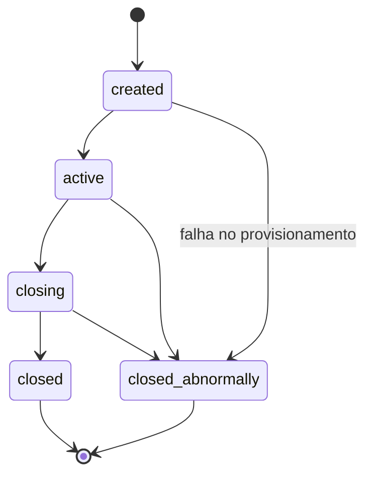
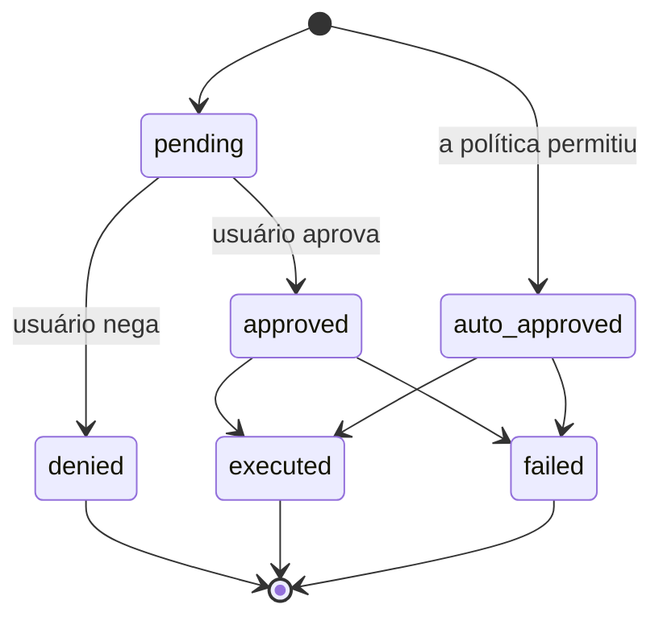
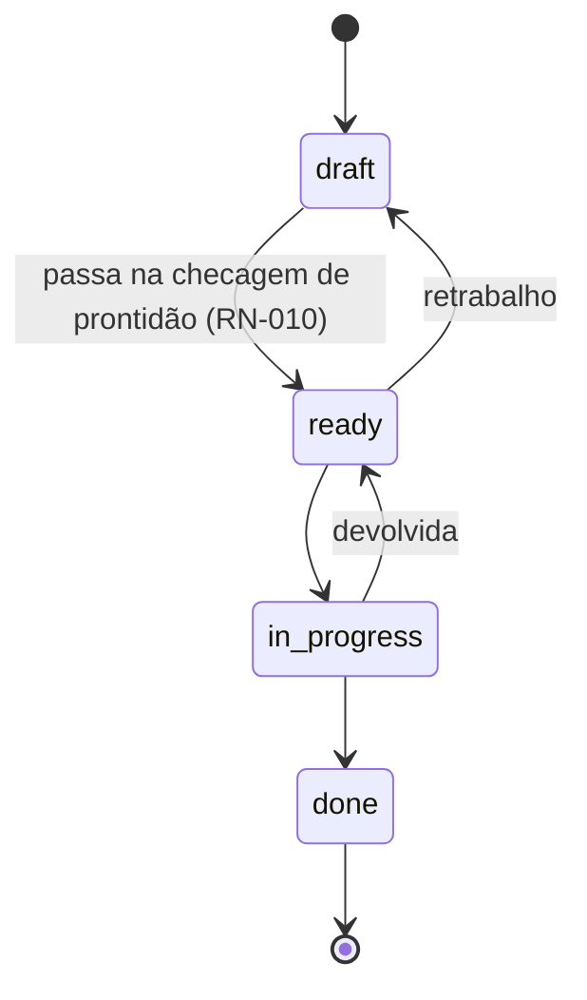
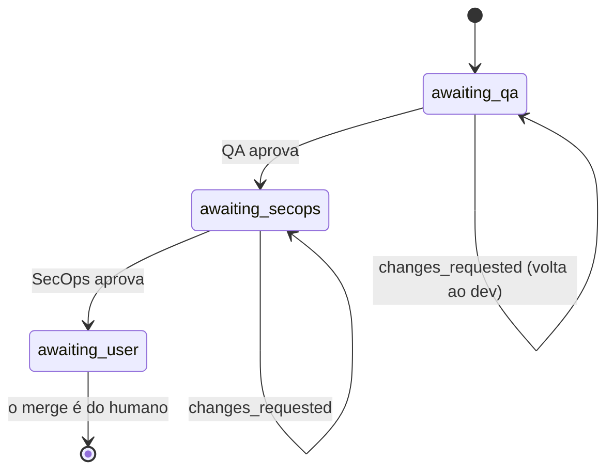

# API — parte 1 (desde RN-001)

## Sessão

O Brabo executa trabalho de engenharia por agentes de IA. Duas forças moldam
praticamente toda regra daqui:

**O agente não é confiável por construção.** É um modelo de linguagem: pode
alucinar, entrar em loop ou pedir algo destrutivo. As regras existem para que
o dano possível seja limitado pela estrutura, não pela qualidade do prompt.

**O gasto é real e contínuo.** Todo turno consome token pago. Orçamento,
teto e medição não são conveniências administrativas — são o que impede um
loop de agente de virar prejuízo.

### Atores

| ator | quem é | autoridade |
|---|---|---|
| **Usuário** | a pessoa. Papéis: `viewer`, `developer`, `maintainer`, `owner` | decisão final sobre qualquer ação com efeito externo; o merge é exclusivamente dele |
| **Agente** | processo de longa duração com um papel (Criativo, PO, Arquiteto, Dev, Infra, QA, SecOps, Psicólogo, Anamnese) | propõe; nunca decide sozinho o que a política não permite |
| **Sistema** | api e engine | aplica a política, registra o evento, mede o custo |

O vocabulário está no [glossário](https://github.com/viralabs-dev/brabo/blob/dev/docs/glossary.md).

---

## Contexto de negócio

### RN-001 — A sessão tem cinco estados e transições fechadas {#rn-001}

`created → active → closing → closed`, com `closed_abnormally` alcançável
de qualquer estado não terminal. **De `closing` nunca há volta para
`active`**, e os estados terminais não têm saída.

- **Onde:** `src/domain/sessions/session-state-machine.ts:29`
- **Teste:** `test/domain/sessions/session-state-machine.spec.ts`
- **Caso de borda:** `closing` é um estado **transitório**. Uma sessão presa
  nele significa que o dreno começou e não terminou — há alerta para isso,
  ver o [runbook](https://github.com/viralabs-dev/brabo-infra/blob/dev/deploy/docs/runbook.md).

### RN-002 — Todo evento de sessão é imutável e o `seq` é denso {#rn-002}

Nunca há `UPDATE` em `session_events`. O `seq` é único por sessão
(`unique(session_id, seq)`) e não tem buracos: começa em 1 e é contíguo.

- **Onde:** `src/db/schema/sessions.ts` (tabela `session_events`)
- **Teste:** conferido no restore — `docker/backup/restore.sh` falha se
  `count(*) ≠ max(seq) − min(seq) + 1` ou `min(seq) ≠ 1`
- **Por quê:** é o que torna rastreável a evidência do Psicólogo e
  verificável o backup. Estado que precisa mudar mora em tabela própria, ao
  lado.

## Aprovação de ações

O coração do sistema. Toda ação com efeito externo nasce como
`proposed_action`.

### RN-003 — A ação tem seis estados, e negada é terminal {#rn-003}

- **Onde:** `src/domain/actions/action-state-machine.ts:36`
- **Teste:** `test/domain/actions/action-state-machine.spec.ts`
- **Caso de borda:** uma ação aprovada que executou vira `executed`, **não**
  continua `approved`. Contar aprovações por `status = 'approved'` dá o
  número errado — o critério correto é `decided_by IS NOT NULL`.

### RN-004 — A decisão é avaliada em três estágios, e `deny` vence na hora {#rn-004}

Ordem: **(a) IAM → (b) `agent_autonomy` → (c) `permissions.json`**. Cada
estágio só pode **subir** a permissividade; um estágio calado nunca rebaixa o
anterior. `deny` em qualquer estágio retorna na hora.

- **Onde:** `src/domain/actions/decide.ts:120`
- **Teste:** `test/domain/actions/decide.spec.ts` (10 KB — o maior do
  domínio)

### RN-005 — Papel mínimo por tipo de ação {#rn-005}

Antes de qualquer política, o IAM: cada `ActionType` exige um papel efetivo
mínimo. Sem ele, `deny` com motivo explícito.

- **Onde:** `src/domain/actions/decide.ts:117` (`MIN_ROLE_FOR_ACTION_TYPE`)
- **Teste:** `test/domain/actions/decide.spec.ts`

### RN-006 — Teto: merge em branch protegida nunca é auto-aprovável {#rn-006}

`dev`, `qa`, `rc` e `main` são protegidas. Um `git_merge` que mira uma delas
é rebaixado de `auto_approve` para `require_approval` **depois** que toda a
política rodou. Nem `agent_autonomy` nem `permissions.json` conseguem
promovê-lo.

`rc` continua na lista mesmo depois que a etapa saiu da política
([ADR 0030](https://github.com/viralabs-dev/brabo/blob/dev/docs/adr/0030-politica-de-branches-mecanizada.md)) e o bootstrap
deixou de criá-la ([RN-029](#rn-029)). Esta lista decide o que a trava
**recusa**, e repositórios criados por versões anteriores ainda têm a
branch: proteger uma que não existe não custa nada; desproteger uma que
existe custa caro.

- **Onde:** `src/domain/actions/decide.ts:523` (`isProtectedBranch`, o teto da trava de merge) + `protected-branches.ts:4`
- **Teste:** `test/domain/actions/decide.spec.ts`
- **Origem:** [ADR 0011](https://github.com/viralabs-dev/brabo/blob/dev/docs/adr/0011-infra-dev-agents-worktrees-merge-lock.md) §1
- **Nota:** a proteção equivalente **na plataforma** (GitHub/GitLab)
  diverge entre os providers e não é o portão — ver
  [ADR 0028](https://github.com/viralabs-dev/brabo/blob/dev/docs/adr/0028-protecao-de-branch-divergencia-entre-providers.md).

### RN-007 — Teto: patch de instrução nunca é auto-aprovável {#rn-007}

Mudar a instrução de um agente sempre exige decisão humana. O valor da
funcionalidade está no humano ver o diff; auto-aprovar seria o agente se
reescrevendo.

- **Onde:** `src/domain/actions/decide.ts:170`
- **Teste:** `test/domain/actions/decide.spec.ts`
- **Origem:** [ADR 0016](https://github.com/viralabs-dev/brabo/blob/dev/docs/adr/0016-anamnese-proficiencia-patches-instrucao.md) §8

### RN-008 — O casamento de comando é por padrão, não por substring {#rn-008}

O `permissions.json` casa um comando de terminal por padrão estruturado, com
o comando devidamente tokenizado — não por `includes()`.

- **Onde:** `src/domain/actions/command-matcher.ts`
- **Teste:** `test/domain/actions/command-matcher.spec.ts`

---

## Backlog

### RN-009 — A história tem quatro estados, e `done` é terminal {#rn-009}

`draft → ready → in_progress → done`. Retrabalho é permitido: `ready → draft` e
`in_progress → ready`.

- **Onde:** `src/domain/backlog/story-state-machine.ts:27`
- **Teste:** `test/domain/backlog/story-state-machine.spec.ts`

### RN-010 — `draft → ready` exige quatro coisas, validadas no domínio {#rn-010}

Para uma história virar `ready` ela precisa, **de todas**:

1. `dod` não vazio — Definition of Done
2. `dor` não vazio — Definition of Ready
3. pelo menos 1 requisito funcional (`rf`)
4. pelo menos 1 regra de negócio ligada (`businessRuleIds`)

O erro nomeia **exatamente o que falta**, não um "inválido" genérico.

- **Onde:** `src/domain/backlog/story-readiness.ts:39`
- **Teste:** `test/domain/backlog/story-readiness.spec.ts`
- **Origem:** [ADR 0009](https://github.com/viralabs-dev/brabo/blob/dev/docs/adr/0009-agente-po-backlog-rastreabilidade.md) §3
- **Por quê:** é o que impede o PO de despejar uma história vaga na fila do
  dev.

### RN-011 — Regra de negócio sem história é achado, não erro {#rn-011}

A cobertura regra→história é calculada, e o que não tem história aparece como
**pendente** — informação, não falha.

- **Onde:** `src/domain/backlog/coverage.ts`
- **Teste:** `test/domain/backlog/coverage.spec.ts`

### RN-013 — O grafo de módulos não pode ter ciclo {#rn-013}

- **Onde:** `src/domain/architecture/module-graph.ts`
- **Teste:** `test/domain/architecture/module-graph.spec.ts`

---

## Gates de PR

### RN-014 — A ordem dos gates é imutável e `awaiting_user` é terminal {#rn-014}

`awaiting_qa → awaiting_secops → awaiting_user`. Aprovar o QA **nunca**
pula direto para o usuário. `changes_requested` devolve ao dev **na mesma
branch**, sem PR nova.

- **Onde:** `src/domain/execution/pr-gate-state-machine.ts:24`
- **Teste:** `test/domain/execution/pr-gate-state-machine.spec.ts`
- **Origem:** [ADR 0013](https://github.com/viralabs-dev/brabo/blob/dev/docs/adr/0013-gates-qa-secops-pr.md) §1
- **Caso de borda:** `awaiting_user` é terminal **por desenho** — o sistema
  nunca faz merge (RN-006).

### RN-015 — Ciclo K: o teto de correção é finito e herdado {#rn-015}

Toda volta de gate consome uma rodada. Esgotado o teto, a tarefa fica
**bloqueada** com motivo, em vez de girar para sempre. Um subagente criado
pela paralelização **herda** o teto do agente-base.

Desde a Fase 8b o teto vale também para a ÁREA de QA, sem mudança de
código: o `QaLeadServer` é o único chamador de `record_gate_verdict`, então
uma rodada de gate — não importa quantas especializações ela consultou por
baixo — continua consumindo exatamente UMA rodada. Ver
[RN-036](https://github.com/viralabs-dev/brabo-engine/blob/dev/docs/business-rules/engine.md#rn-036).

- **Onde:** `DEFAULT_MAX_GATE_CORRECTIONS = 3` em
  `src/application/use-cases/execution/record-gate-verdict.use-case.ts:21`;
  aplicado em `activate-execution.use-case.ts:89` e, no engine, em
  `qa_lead_server.ex:268` e `secops_agent_server.ex:142`
- **Teste:** `apps/engine/test/engine/gates/qa_automacao_agent_test.exs`
  (a especialização devolve `{:blocked, ...}` sem chamar a api)
  e `qa_lead_server_test.exs` (o Lead NUNCA chama
  `record_gate_verdict` nesse caso — é isso que impede a correção de ser
  queimada)
- **Origem:** [ADR 0017](https://github.com/viralabs-dev/brabo/blob/dev/docs/adr/0017-lock-de-workspace-e-monitor-de-dev-agents.md) §4

### RN-017 — Orçamento tem escopo exclusivo: projeto **ou** sessão {#rn-017}

Um `budget` referencia um projeto ou uma sessão, nunca os dois — garantido
por um `check` no banco de dados, não só no código.

- **Onde:** `src/db/schema/llm.ts` (`budgets_scope_check`)
- **Teste:** a constraint é a garantia

### RN-018 — Notificação de orçamento em 70%, 90% e 100%, sem repetir {#rn-018}

Cada limiar dispara **uma vez**; o último notificado fica persistido em
`budgets.last_threshold_notified`.

- **Onde:** `src/domain/llm/budget-threshold.ts:1`
- **Teste:** `test/domain/llm/budget-threshold.spec.ts`

### RN-019 — `policy = 'block'` recusa a chamada; `'allow'` só registra {#rn-019}

- **Onde:** `src/domain/llm/budget-threshold.ts:4`
- **Caso de borda:** um projeto em `allow` **não se detém** no teto. É a
  causa mais comum de "o orçamento não segurou" — veja o
  [runbook](https://github.com/viralabs-dev/brabo-infra/blob/dev/deploy/docs/runbook.md).

### RN-020 — O modelo é resolvido em cascata, do mais específico ao mais geral {#rn-020}

`session > agent > area > project > workspace`. Vence o primeiro que
existir. `area` entrou na FASE 23 — veja a [RN-102](parte-03.md#rn-102) para a posição
dela e o que muda para quem já leu esta cascata.

- **Onde:** `src/domain/llm/binding-resolver.ts`
- **Teste:** `test/domain/llm/binding-resolver.spec.ts`

## Psicólogo e Anamnese {#psicologo-e-anamnese}

### RN-021 — Hipótese sem evidência válida não é gravada {#rn-021}

Os `evidenceEventIds` precisam apontar para eventos **que existem e pertencem à
sessão analisada**. A validação é atômica por lote: um id inválido reprova o
lote inteiro.

- **Onde:** `src/domain/psychologist/hypothesis-evidence.ts`
- **Teste:** `test/domain/psychologist/hypothesis-evidence.spec.ts`
- **Origem:** [ADR 0015](https://github.com/viralabs-dev/brabo/blob/dev/docs/adr/0015-psicologo-real-toolloop-hipoteses-evidencia.md) §3

### RN-022 — O ciclo de vida da hipótese é compare-and-swap {#rn-022}

`proposed → accepted | dismissed`. Duas decisões concorrentes sobre a mesma
hipótese: uma vence, a outra recebe conflito — não 500, não silêncio.

- **Onde:** `src/domain/psychologist/hypothesis-lifecycle.ts`
- **Teste:** `test/domain/psychologist/hypothesis-lifecycle.spec.ts`
- **Origem:** [ADR 0022](https://github.com/viralabs-dev/brabo/blob/dev/docs/adr/0022-fechamento-4b-psicologo.md) §7

### RN-024 — A Anamnese só perfila competência do catálogo — guarda-corpo estrutural {#rn-024}

Competências de processo são **seis**, fechadas: `git`, `agile`, `arquitetura`,
`testes`, `seguranca`, `infra`. Mais as stacks técnicas derivadas do
`module_map`. Qualquer outra coisa — "ansiedade", "saúde mental" — **não tem
caminho de escrita**: é erro no domínio, não instrução de prompt.

- **Onde:** `src/domain/anamnese/competency-catalog.ts:16`
- **Teste:** `test/domain/anamnese/competency-catalog.spec.ts`
- **Origem:** [ADR 0016](https://github.com/viralabs-dev/brabo/blob/dev/docs/adr/0016-anamnese-proficiencia-patches-instrucao.md) §1
- **Por quê:** a Anamnese perfila **competência técnica**, não pessoa. O limite
  é estrutural porque uma instrução de prompt não é garantia.

### RN-025 — Apagar o perfil apaga de verdade, e o opt-out impede a re-derivação {#rn-025}

- **Onde:** `src/domain/anamnese/proficiency-profile.entity.ts` +
  tabela `anamnese_opt_outs`
- **Origem:** [ADR 0016](https://github.com/viralabs-dev/brabo/blob/dev/docs/adr/0016-anamnese-proficiencia-patches-instrucao.md) §2

### RN-026 — Patch de instrução negado não é reproposto {#rn-026}

A comparação é sobre o conteúdo **normalizado**, não sobre o texto literal:
reindentar o mesmo patch não o transforma em proposta nova. Não há tabela de
dedup — a fonte é o próprio histórico de `proposed_action` com `actionType =
instruction_patch` e `status = denied`.

- **Onde:** `src/domain/instructions/patch-dedup.ts:22`
- **Teste:** `test/domain/instructions/patch-dedup.spec.ts`

### RN-027 — Rollback de instrução é operação **para frente** {#rn-027}

Reverter cria uma versão nova com o conteúdo antigo; não apaga histórico. A
tabela de versões é append-only.

- **Onde:** `src/domain/instructions/`
- **Origem:** [ADR 0016](https://github.com/viralabs-dev/brabo/blob/dev/docs/adr/0016-anamnese-proficiencia-patches-instrucao.md) §4

---

## Git

### RN-029 — O bootstrap de Gitflow é idempotente e retomável {#rn-029}

Cinco passos; cada um verifica antes de agir e pode ser retomado do ponto que
falhou. `skip` é sucesso, não erro.

Eram seis. O sexto criava a branch `rc`, degrau que o
[ADR 0030](https://github.com/viralabs-dev/brabo/blob/dev/docs/adr/0030-politica-de-branches-mecanizada.md) removeu da política —
o bootstrap continuou criando, protegendo e **documentando no repositório do
usuário** uma escada que o produto já tinha abandonado (achado #3 do primeiro
dogfooding). O valor `create_rc_branch` continua no enum `bootstrap_step`:
linhas antigas o referenciam, e passo que aconteceu de verdade não se apaga do
histórico.

- **Onde:** `src/application/use-cases/git/bootstrap-steps.ts` +
  `domain/git/repo-bootstrap.entity.ts` (`RETIRED_BOOTSTRAP_STEPS`)
- **Teste:** `test/domain/git/repo-bootstrap-status.spec.ts`
- **Origem:** [ADR 0005](https://github.com/viralabs-dev/brabo/blob/dev/docs/adr/0005-repo-bootstrap-idempotent-steps.md)

---

### RN-030 — Reapresentar um refresh já usado revoga a família inteira {#rn-030}

Cada refresh consome o token apresentado e emite um filho com o **mesmo**
`family_id` e o mesmo `family_started_at`. Apresentar um token que já foi
consumido é a assinatura de um roubo — alguém está usando uma cópia — e a
resposta é revogar todos os tokens vivos daquela família, com evento de
segurança.

O usuário legítimo é deslogado junto. Isso é o comportamento correto, não um
defeito: do lado do servidor, um duplo-submit do cliente e um replay de ladrão
são idênticos.

- **Onde:** `src/domain/auth/refresh-token.ts:50` +
  `application/use-cases/auth/refresh.use-case.ts:98`
- **Teste:** `test/application/use-cases/auth/rotacao-e-reuso.spec.ts`
- **Borda:** quem apresenta um token de família **já revogada** é vítima a
  jusante, não novo roubo: registra `refresh_revoked` e **não** dispara segunda
  cascata. Sem essa distinção, cada aba do usuário legítimo geraria um alarme
  falso durante o incidente.
- **Origem:** [ADR 0031](https://github.com/viralabs-dev/brabo/blob/dev/docs/adr/0031-auth-first-party-argon2id-e-rotacao-de-refresh.md)

### RN-031 — Falha de login é contada por e-mail e por IP, e o bloqueio escala {#rn-031}

Janela deslizante de 15 minutos no Postgres, sem Redis. Dois baldes por
tentativa e o mais restritivo vence: e-mail (5 falhas → 30s, 8 → 5min, 12 →
15min) e IP (20 → 30s, 30 → 2min). Um login bem-sucedido limpa o balde do
e-mail; o de IP drena só por tempo.

A chave do balde é o **e-mail normalizado**, nunca o id do usuário. Com id, o
balde só existiria depois de encontrar a conta, e o próprio lockout viraria
oráculo de existência.

- **Onde:** `src/domain/auth/lockout-policy.ts:97` +
  `infrastructure/persistence/drizzle/drizzle-login-throttle.ts:74`
- **Teste:** `test/application/use-cases/auth/lockout.spec.ts`
- **Borda:** enquanto bloqueado, a tentativa **não** é registrada. Se fosse, um
  atacante manteria a conta da vítima travada para sempre só continuando a
  tentar — o lockout viraria negação de serviço contra quem ele protege.
- **Por quê:** o balde de IP não pode ser limpo no sucesso; quem tem uma conta
  válida zeraria a janela à vontade e pulverizaria palpites sem limite.
- **Origem:** [ADR 0031](https://github.com/viralabs-dev/brabo/blob/dev/docs/adr/0031-auth-first-party-argon2id-e-rotacao-de-refresh.md)

### RN-032 — Nenhuma resposta distingue conta existente de inexistente {#rn-032}

Qualquer resposta diferente da falha uniforme só é alcançável **depois** de uma
verificação de senha bem-sucedida. No login, e-mail inexistente, senha errada e
conta bloqueada devolvem o mesmo 401 e gastam o mesmo tempo — o ramo sem conta
verifica contra um hash dummy gerado com **os mesmos parâmetros** do real. No
registro e no pedido de reset, endereço conhecido e desconhecido devolvem 202.

- **Onde:** `src/application/use-cases/auth/login.use-case.ts:79` +
  `register.use-case.ts:74`
- **Teste:** `test/application/use-cases/auth/enumeracao.spec.ts`
- **Borda:** a checagem de bloqueio por e-mail roda **depois** do argon2, não
  antes. Sair mais cedo é a otimização que qualquer revisor sugeriria, e é
  exatamente o vazamento — o teste fica vermelho se alguém a introduzir.
- **Borda:** o usuário MIGRADO do Keycloak (existe em `users`, sem linha em
  `auth_credentials`) também recebe o 401 uniforme — e o link de "definir
  senha" é disparado em silêncio. Responder `password_pending` confirmaria que
  o endereço existe **e** que é conta legada. Por isso `findByEmail` é um LEFT
  JOIN numa consulta só: duas consultas encadeadas fariam esse ramo pagar uma
  ida a mais ao banco, e o relógio revelaria o que o corpo esconde.
- **Por quê:** o que se afirma é "nenhum ramo pula o trabalho caro e nenhum
  produz resposta distinguível", **não** tempo constante. Ver as consequências
  no ADR.
- **Origem:** [ADR 0031](https://github.com/viralabs-dev/brabo/blob/dev/docs/adr/0031-auth-first-party-argon2id-e-rotacao-de-refresh.md),
  borda do migrado em
  [ADR 0032](https://github.com/viralabs-dev/brabo/blob/dev/docs/adr/0032-corte-do-keycloak-e-sessao-em-cookie.md)

### RN-033 — Token de verificação e de reset vale uma vez só {#rn-033}

Consumo por UPDATE condicional com `returning`: o próprio UPDATE é a guarda.
Zero linhas cobre inexistente, de outro propósito, já consumido, invalidado e
expirado — todos com a mesma resposta. Pedir um link novo invalida o anterior.
Concluir um reset revoga **todas** as sessões do usuário e não emite tokens.

- **Onde:** `src/infrastructure/persistence/drizzle/account-token.repository.ts:76`
- **Teste:** `test/application/use-cases/auth/tokens-de-conta.spec.ts`
- **Borda:** dois envios simultâneos não passam os dois. A corrida é o caso
  **normal**, não a exceção: scanner de e-mail corporativo abre todo link de
  toda mensagem, então o robô costuma consumir o token antes do humano clicar.
- **Por quê:** o reset não emite sessão de propósito — logar direto a partir de
  um link recebido por e-mail faria comprometer o e-mail equivaler a tomar a
  conta, sem segundo passo.
- **Origem:** [ADR 0031](https://github.com/viralabs-dev/brabo/blob/dev/docs/adr/0031-auth-first-party-argon2id-e-rotacao-de-refresh.md)

### RN-034 — A sessão da web vive em cookie httpOnly, com CSRF {#rn-034}

O refresh token vai num cookie `brabo_refresh` (`httpOnly`, `SameSite=Strict`,
`Path=/auth`, `Secure` em produção) e **não** aparece no corpo de nenhuma
resposta. O access token, de 15 minutos, fica em memória no cliente e viaja no
`Authorization: Bearer`.

`/auth/refresh` e `/auth/logout` exigem `X-CSRF-Token` igual ao cookie
`brabo_csrf`, comparado em tempo constante.

- **Onde:** `src/interfaces/http/auth/session-cookies.ts:53` +
  `interfaces/http/auth/auth.controller.ts`
- **Teste:** `test/interfaces/session-cookies.spec.ts`
- **Borda:** falha de CSRF é **403**, não 401. Com 401 o cliente tentaria
  renovar a sessão e entraria em laço — a credencial está boa, quem está errada
  é a requisição.
- **Por quê:** devolver o refresh também no corpo anularia o `httpOnly` —
  bastaria um XSS ler a resposta do login, e levaria a sessão longa em vez dos
  15 minutos do access.
- **Origem:** [ADR 0032](https://github.com/viralabs-dev/brabo/blob/dev/docs/adr/0032-corte-do-keycloak-e-sessao-em-cookie.md)

### RN-035 — O tráfego interno engine ↔ api exige o segredo de serviço {#rn-035}

As 32 rotas `/internal/*` são `@ServiceRoute()`: ficam fora do JWT de usuário e
fora do rate limit. Quem autentica é o `EngineServiceGuard`, comparando
`X-Brabo-Service-Token` com `BRABO_SERVICE_TOKEN` em tempo constante. O mesmo
segredo vale nos dois sentidos, e `BRABO_SERVICE_TOKEN_PREVIOUS` é aceito só na
verificação, para a rotação não ter janela de indisponibilidade.

- **Onde:** `src/interfaces/http/auth/engine-service.guard.ts:44` +
  `infrastructure/security/service-token.ts` +
  `apps/engine/lib/engine_web/plugs/verify_service_token.ex`
- **Teste:** `apps/engine/test/engine_web/plugs/verify_service_token_test.exs`,
  `test/interfaces/route-surface.spec.ts` e, para a rotação do lado da api
  (anterior aceito só na verificação, quem chama manda o atual, removido o
  anterior o velho cai), `test/infrastructure/security/service-token.spec.ts`
  (describe "rotação do BRABO_SERVICE_TOKEN") e
  `test/interfaces/engine-service.guard.spec.ts` ([RN-597](parte-07.md#rn-597))
- **Borda:** a isenção de rate limit vem do METADADO da rota, não do guard. O
  `RateLimitGuard` é `APP_GUARD` e roda antes de qualquer guard de controller —
  quando ele decide, o `EngineServiceGuard` ainda não rodou.
- **Origem:** [ADR 0032](https://github.com/viralabs-dev/brabo/blob/dev/docs/adr/0032-corte-do-keycloak-e-sessao-em-cookie.md)

### RN-038 — Agente contado no resumo do workspace = gastou tokens este mês {#rn-038}

O resumo do dashboard de projetos ("N projetos ativos · M agentes · gasto
este mês") conta como "agente" quem tem pelo menos uma linha em
`token_usage` com `actor_kind = 'agent'` no mês corrente, somando todos os
projetos do workspace. Sem o filtro de `actor_kind`, um `user` mandando
chat ou um `system` registrando uso inflaria a contagem — `token_usage`
grava para qualquer tipo de ator, não só agente. O corte por mês usa
`created_at >= date_trunc('month', now())`; um agente que trabalhou só no
mês anterior não conta, mesmo que ainda apareça no roster de alguma
sessão. A contagem naturalmente inclui as subespecialidades de área da
Fase 8 (`qa-automacao`, `qa-performance-seguranca`, `infra-workflows`):
cada uma tem seu próprio `actor_id` quando gasta tokens.

- **Onde:** `src/infrastructure/persistence/drizzle/token-usage.repository.ts`
  (`summarizeForWorkspaceThisMonth`)
- **Teste:** `test/application/use-cases/iam/get-workspace-summary.use-case.spec.ts`

---

### RN-040 — Binding de agente exige tool calling nativo {#rn-040}

Vincular um modelo a um **agente** (`scope = 'agent'`) só é permitido se o
modelo tiver `supports_tool_calling`. Um agente só existe dentro do
ToolLoop, e o ToolLoop só funciona se o modelo souber **pedir** ferramentas;
sem isso, a falha apareceria adiante como "o agente parou sem terminar",
que é exatamente o diagnóstico por eliminação que o
[ADR 0020](https://github.com/viralabs-dev/brabo/blob/dev/docs/adr/0020-destravar-gates-qa-secops.md) proibiu. A recusa é um
422 e a mensagem aponta para o filtro **"aptos para agentes"** — sem esse
apontamento a regra vira um beco sem saída.

O `ToolCallRecovery` do engine recupera chamadas que o modelo escreveu em
prosa, mas é um **resgate, não uma licença**: depende de o modelo acertar o
formato por acaso.

Só `agent` valida. `workspace` e `project` são o fallback do chat humano e
`session` é conversa — nenhum deles roda um ToolLoop, e travá-los proibiria
modelos só de chat no produto. O agente `context-manager` está coberto por
construção: é um slug **dentro** do escopo `agent`, não um escopo próprio.

**Nota aditiva — o filtro passou a vir MARCADO, e quem o liga é o ESCOPO.** O
parágrafo acima diz que a recusa aponta para o filtro "aptos para agentes",
"senão a regra vira beco sem saída" — e por muito tempo ela foi um: o prop que
abre o seletor com o filtro marcado existia desde a Fase 9c e **nenhuma tela de
produção o passava**. O seletor de um agente abria oferecendo modelo chat-only
cujo clique só existia para ser recusado. As duas telas que gravam num escopo
validado passam a abrir filtradas — `ModelsSection` (agente e a caixa
da área na linha do lead, RN-912) —, e a régua de quem liga não é a tela e sim
`assertModelFitsBindingScope`: onde a api RECUSA, o filtro vem marcado; onde ela
não recusa, quem escolhe é a pessoa. Por isso o seletor de SESSÃO continua sem
filtro — marcar ali esconderia modelo que a api aceita. **Isto não elimina o
422**: o filtro cobre uma das três causas, e as outras duas
([RN-043](#rn-043) — desativado no workspace, sumido do provider) seguem
alcançáveis, com o indisponível ainda LISTADO e marcado; o desfecho de recusa da
[RN-470](https://github.com/viralabs-dev/brabo-web/blob/dev/docs/business-rules/web.md#rn-470) continua sendo o que conta o que houve. E é estado INICIAL de
um checkbox, não trava: desmarcar volta a listar tudo.

**A consequência: o vigente que o filtro esconde é DITO.** `workspace` e
`project` nunca exigiram tool calling, e as rotas que resolvem o binding de um
agente ou de uma área chamam `ResolveModelBindingUseCase` **sem**
`exigeToolCalling` — então um padrão chat-only desses níveis é resolvido
normalmente e vira o vigente da linha. Com o filtro marcado, o gatilho mostrava
um nome que a lista aberta não continha, sem nenhuma opção marcada. O picker
agora nomeia o modelo e a causa; ele PODE nomear a causa porque só há um filtro
ali. Quando a lista inteira fica vazia, quem fala continua sendo o texto de
lista vazia, que já manda desmarcar — dois avisos sobre o mesmo checkbox seriam
ruído.

**Correção de fato, não do texto acima:** "Only `agent` validates" descreve a
Fase 9a. Desde o [ADR 0064](https://github.com/viralabs-dev/brabo/blob/dev/docs/adr/0064-escopo-de-area-na-cascata-e-o-binding-de-agente-global.md)
`area` entra na MESMA validação — ela não é fallback genérico, o único consumidor
do modelo de uma área é um agente dela ([RN-102](parte-03.md#rn-102)) —, e é por isso que
são DUAS as telas que ligam o filtro.

- **Onde:** `src/domain/llm/model-capabilities.ts:38`;
  `apps/web/src/components/ModelPicker.tsx` (o filtro e o aviso de vigente
  escondido), `apps/web/src/routes/settings/ModelsSection.tsx` (quem o liga,
  no seletor do agente e no do lead que segue a área)
- **Teste:** `test/domain/llm/model-capabilities.spec.ts`,
  `test/application/use-cases/llm/set-model-binding.use-case.spec.ts`;
  `apps/web/src/routes/settings/filtro-de-aptos.test.tsx` e
  `apps/web/src/routes/SessionPage.filtro-de-aptos.test.tsx` (as duas telas que
  ligam, e a que não liga)
- **Origem:** [ADR 0041](https://github.com/viralabs-dev/brabo/blob/dev/docs/adr/0041-base-openai-compativel-e-contrato-de-llm-providers.md)

### RN-041 — Contagem de tokens que o provider não deu é marcada como estimada {#rn-041}

Quando a resposta do provider não traz `usage`, a base compatível com
OpenAI conta localmente com o tokenizer e emite o chunk com
`estimated: true`. O número ainda serve para cobrança, mas a marca preserva
a diferença entre **"o provider disse zero"** e **"o provider não disse
nada"** — e é o que permite à UI qualificar o custo em vez de mostrar um
valor sem procedência.

Os outros dois providers divergem, e a divergência é normalizada, não
escondida: o Ollama simplesmente não emite `usage` sem a linha `done`; o
Anthropic não pode omitir a contagem, porque `usage` é obrigatório no
`message_start` do protocolo dele. As três respostas estão em
[docs/reference/llm-providers.md](../../reference/llm-providers.md#normalized-divergences).

- **Onde:** `src/infrastructure/llm/openai-compatible-provider.ts:167`
- **Teste:** `test/contract/llm-provider.contract.ts` (cenário
  `sem_usage`, rodado contra os três providers)
- **Origem:** [ADR 0041](https://github.com/viralabs-dev/brabo/blob/dev/docs/adr/0041-base-openai-compativel-e-contrato-de-llm-providers.md)

### RN-042 — O metering registra quem ATENDEU a chamada, não só por onde ela entrou {#rn-042}

Quando a chamada passa por um hub que informa o provider real,
`token_usage` registra esse provider em `upstream_provider`, além do
provider de entrada. Sem hub — ou com um hub que não informou — o campo é
**`null`**, nunca string vazia: a consulta de custo por provider precisa
distinguir "não passou por hub" de "passou por um e o hub não disse".

Nas métricas, o rótulo `upstream_provider` repete o próprio provider quando
não há hub, de modo que `sum by (upstream_provider)` continua somando o
custo inteiro.

- **Onde:** `src/application/use-cases/llm/record-llm-usage.use-case.ts:73`
- **Teste:** `test/application/use-cases/llm/record-llm-usage.use-case.spec.ts`
- **Origem:** [ADR 0041](https://github.com/viralabs-dev/brabo/blob/dev/docs/adr/0041-base-openai-compativel-e-contrato-de-llm-providers.md)

### RN-043 — Um modelo descoberto entra desabilitado; um modelo que desaparece é marcado, nunca apagado {#rn-043}

A sincronização do catálogo tem três desfechos, e nenhum é destrutivo:

1. **Um modelo novo** entra **sem linha de curadoria em nenhum workspace**,
   e a ausência de linha É o estado desabilitado. O catálogo de um provider
   tem centenas de linhas — despejá-las como ativas tornaria a escolha
   impossível e ligaria um modelo caro sem que ninguém decidisse. Ativar é a
   curadoria do owner, e vale só no workspace dele ([RN-052](#rn-052)).
2. **Um modelo que sumiu do catálogo remoto** recebe
   `availability = 'unavailable'` e **permanece na tabela**:
   `model_bindings` e `token_usage` apontam para a linha, e apagá-la levaria
   junto o histórico de custo.
3. **Um modelo que voltou** retorna a `available` com a curadoria
   **intacta** — a escolha do owner sobrevive a uma ausência temporária do
   provider.

Os dois eixos são deliberadamente independentes: a curadoria é decisão de
uma pessoa, `availability` é uma observação do provider. Nenhum escreve no
outro — e desde o [ADR 0049](https://github.com/viralabs-dev/brabo/blob/dev/docs/adr/0049-curadoria-de-modelo-por-workspace.md)
eles nem moram na mesma tabela, então a sincronização não tem campo de
curadoria para atropelar, mesmo que quisesse.

Três consequências no resto do sistema:

- um binding **NOVO** para um modelo inativo ou indisponível é recusado no
  domínio (`ModelNotBindableError`, 422). Os bindings que já existem
  permanecem;
- a **cascata** do `resolveBinding` pula o candidato indisponível, registra
  o que pulou em `skipped` e — quando o turno leva ferramentas — revalida
  `supports_tool_calling` em TODOS os níveis. Sem isso, o fallback pousaria
  um agente num modelo só de chat e violaria a [RN-040](#rn-040) em silêncio;
- **um provider que falhou não torna nada indisponível**: um 401 é "não sei
  o que há ali", não "não há nada ali". O provider é pulado, com a ORIGEM da
  falha (`infra` | `modelo`) no relatório — nunca diagnóstico por
  eliminação.

- **Onde:** `src/application/use-cases/llm/sync-model-catalog.use-case.ts:160`,
  `src/domain/llm/binding-resolver.ts:63`,
  `src/domain/llm/model-capabilities.ts:49`
- **Teste:** `test/application/use-cases/llm/sync-model-catalog.use-case.spec.ts`,
  `test/domain/llm/binding-resolver.spec.ts`,
  `test/application/use-cases/llm/set-model-binding.use-case.spec.ts`
- **Origem:** [ADR 0042](https://github.com/viralabs-dev/brabo/blob/dev/docs/adr/0042-catalogo-vivo-ciclo-de-vida-do-modelo-e-preco-auditavel.md)

### RN-044 — O preço vale daqui para a frente, e o custo antigo continua conferindo {#rn-044}

Toda linha de `token_usage` registra o preço que produziu o seu
`cost_micros`. Mudar o preço de um modelo **não reprecifica o consumo
passado** — e mais que isso: o custo antigo continua **reproduzível**,
porque `tokens × preço registrado` bate com o custo registrado mesmo depois
de três correções na tabela `models`.

Toda mudança de preço grava uma linha em `model_price_changes`, append-only,
com o par antes/depois e a origem (`manual` | `sync`). O par é gravado junto
de propósito: reconstruir o "antes" a partir da linha anterior dependeria de
nenhuma escrita ter escapado do caminho auditado, que é exatamente o que a
auditoria existe para provar. Um preço igual ao atual é no-op — uma linha
dizendo "mudou de 10 para 10" transformaria o log em ruído.

A regra vale para **todo** caminho que muda preço, não só o da tela. Duas
escritas costumavam escapar dela: a sincronização do catálogo (que mudava o
preço via `upsert`, nunca produzindo a origem `sync` que o domínio declarava
desde a Fase 9c) e o `seed.ts` (que roda num banco já semeado —
`BRABO_FORCE_SEED=1` no `bootstrap.sh` do k8s — e portanto corrigia o preço
em silêncio). Ambos agora auditam, com o seed reaproveitando o próprio
`UpdateModelPricingUseCase`.

- **Onde:** `src/application/use-cases/llm/update-model-pricing.use-case.ts:44`,
  `src/application/use-cases/llm/sync-model-catalog.use-case.ts:213`,
  `src/db/seed.ts:376`
- **Teste:** `test/application/use-cases/llm/update-model-pricing.use-case.spec.ts`,
  `test/application/use-cases/llm/sync-model-catalog.use-case.spec.ts`
- **Origem:** [ADR 0042](https://github.com/viralabs-dev/brabo/blob/dev/docs/adr/0042-catalogo-vivo-ciclo-de-vida-do-modelo-e-preco-auditavel.md)

### RN-045 — Um repositório adotado só é alterado por um plano aprovado {#rn-045}

Adotar um repositório existente **diagnostica sem agir**. A adoção valida o
acesso (`getRepo`), grava as linhas do projeto e produz um **plano**: a lista
serializada do que o bootstrap faria, obtida chamando o `check()` de cada
passo — o mesmo que dá idempotência desde a [RN-029](#rn-029)
— sem nunca executar a mutação correspondente.

Enquanto `repo_bootstraps.plan_decision` é **nulo**, nenhuma mutação roda. O
portão fica **antes** do executor, não dentro dele: o runner do bootstrap é o
mesmo da Fase 2, sem filtro, e simplesmente não é chamado. Somado à guarda
que já pulava branches protegidas, não há caminho de código que toque uma
branch fora de um plano aprovado.

Os dois desfechos:

- **aprovar** é tudo ou nada (aprovar passos soltos quebraria a cascata
  `dev←main, qa←dev`). O que executa é o plano **rederivado** no momento da
  execução: igual ou menor que o mostrado, **nunca maior** — uma branch que
  virou protegida nesse meio-tempo é pulada;
- **adotar como está** dispensa o bootstrap, registra a decisão e **não**
  mexe no cursor para fingir convergência. O plano é guardado como evidência
  do que foi deliberadamente não aplicado.

Decidir sobre um plano regenerado é recusado (409): a decisão carrega o
`planGeneratedAt` que o usuário viu, e um "sim" dado sobre outra coisa não
vale.

O provisionamento normal recusa (409) rodar num repositório adotado — sem
essa guarda, o caminho de retomada rodaria o bootstrap no repositório de
terceiros sem plano nenhum.

**Limite conhecido:** "proteção divergente" aqui é presença × ausência,
porque é só isso que o contrato expõe (`GitBranch.protected` é um booleano, e
o [ADR 0028](https://github.com/viralabs-dev/brabo/blob/dev/docs/adr/0028-protecao-de-branch-divergencia-entre-providers.md)
adiou uma `ProtectionPolicy` normalizada). Uma branch com proteção PARCIAL
conta como "desprotegida" e pode ser sobrescrita — mas só dentro de um plano
aprovado.

- **Onde:** `src/application/use-cases/git/decide-bootstrap-plan.use-case.ts`,
  `src/application/use-cases/git/bootstrap-plan.ts`,
  `src/application/use-cases/git/bootstrap-steps.ts:74`
- **Teste:** `test/application/use-cases/git/decide-bootstrap-plan.use-case.spec.ts`,
  `test/application/use-cases/git/bootstrap-plan.spec.ts`
- **Origem:** [ADR 0044](https://github.com/viralabs-dev/brabo/blob/dev/docs/adr/0044-adocao-de-repositorio-existente.md)

### RN-046 — Todo repositório de projeto declara a sua origem {#rn-046}

`project_repositories.origin` e `repo_bootstraps.origin` dizem se o Brabo
**criou** o repositório (`created`) ou **adotou** um que já existia
(`adopted`). A origem é escrita explicitamente por quem grava a linha — não
pelo default da coluna — e não muda depois.

Não é decoração: é o que faz o produto tratar como caso legítimo o que a
Fase 10 precisou fazer à mão (inserir linhas em `project_repositories` e
`repo_bootstraps` para apontar um projeto para um fork). Um repositório
`adopted` tem política de branches própria, não passa pelo provisionamento e
só é alterado conforme a [RN-045](#rn-045).

O backfill da migration `0031` marca tudo que já existia como `created`, e
pode ser cego quanto a isso: a adoção não existia antes dela, então não há
linha adotada para classificar errado.

- **Onde:** `src/db/schema/git.ts`, `src/db/migrations/0031_special_winter_soldier.sql`,
  `src/domain/git/repo-bootstrap.entity.ts`
- **Teste:** `test/application/use-cases/git/adopt-repository.use-case.spec.ts`
- **Origem:** [ADR 0044](https://github.com/viralabs-dev/brabo/blob/dev/docs/adr/0044-adocao-de-repositorio-existente.md)

### RN-048 — A promoção de story é do usuário por padrão; o modo muda quem dispara, nunca o que se valida {#rn-048}

`projects.story_promotion` escolhe QUEM promove uma story de `draft` para
`ready`:

- **`manual`**: o PO deixa a story completa e ela fica `draft` com
  `stories.proposed_ready = true`. **Nenhuma de suas tarefas é pegável** — o
  `claimNext` exige `story.status = 'ready'` — e é o usuário quem a promove,
  individualmente ou em lote, a partir do Backlog.
- **`auto`** (default de projeto novo desde a [RN-659](parte-08.md#rn-659)):
  o PO promove por conta própria ao terminar uma story completa. Esse era o
  comportamento anterior à Fase 12c; `manual` foi o default da 12c até a
  RN-659 (migration `0065`), que mudou só o default da coluna — projetos
  criados no meio do caminho continuam `manual`.

**O modo muda o gatilho, não o critério.** Os dois caminhos passam por
`assertPromotable` — prontidão (RF/DoD/DoR/regra) e módulos resolvidos contra
o `module_map` vigente — e é isso que o teste de simetria em
`story-promotion.spec.ts` trava: para toda story, `isPromotable` concorda com
o que `assertPromotable` levanta. Antes da fase, a validação era duplicada e
assimétrica (a criação chamava `canBecomeReady`, a transição chamava
`assertReady` + `assertModulesResolved`): duas portas para o mesmo estado,
com fechaduras diferentes. Tornar o gatilho configurável exigiu unificá-las
primeiro, senão "promover pela UI" e "promover na criação" seriam regras
distintas com o mesmo nome.

Uma story **incompleta** nunca é proposta. `proposed_ready` só liga quando a
story já passaria na validação — propor o que o domínio recusaria empurraria
o trabalho do PO para o usuário disfarçado de decisão.

A **recusa** devolve a story ao PO: grava `returned_reason`/`returned_at`,
desliga `proposed_ready`, emite `backlog.story_promotion_returned` e injeta o
motivo como mensagem FIXADA na sessão do PO, com a mesma redação de
precedência de um gate devolvido ao dev (lição do ADR 0020). A recusa é
gravada **antes** de falar com o engine, e o engine falhar não a desfaz — é o
inverso da ordem do rearme na [RN-047](https://github.com/viralabs-dev/brabo-engine/blob/dev/docs/business-rules/engine.md#rn-047), e por um motivo: lá o evento
afirma algo SOBRE o engine, aqui ele afirma algo sobre o usuário, o que é
verdade haja ou não um PO de plantão para ouvir.

A promoção em lote **não é tudo ou nada**: cada story é a sua própria
transação, e uma que perdeu a prontidão entre a proposta e a decisão volta
`failed` com o motivo, sem derrubar as outras que o usuário acabou de
revisar.

O evento `backlog.story_transitioned` registra o **ator real** — `user` na
promoção manual, `agent/po` na automática. O event log é imutável e é o que a
auditoria lê: registrar o PO numa decisão do usuário apagaria exatamente a
etapa humana que a regra existe para devolver.

A migration `0033` faz um backfill **dirigido**, não cego: a coluna nasce
`manual` e todo projeto que já existia é movido para `auto`. O novo default
vale para quem vier depois; um projeto em andamento não pode parar de
produzir por causa de um deploy.

- **Onde:** `src/domain/backlog/story-promotion.ts`,
  `src/db/migrations/0033_absurd_domino.sql`,
  `src/application/use-cases/backlog/promote-stories.use-case.ts`,
  `src/application/use-cases/backlog/return-story.use-case.ts`,
  `apps/engine/lib/engine/agents/po_server.ex` (`revision_message/1`)
- **Teste:** `test/domain/backlog/story-promotion.spec.ts` (simetria),
  `test/db/story-promotion-migration.spec.ts` (backfill dirigido),
  `test/application/use-cases/backlog/promote-stories.use-case.spec.ts`,
  `test/application/use-cases/backlog/return-story.use-case.spec.ts`,
  `apps/engine/test/engine/agents/po_server_test.exs` (describe `revise/2`)
- **Origem:** [ADR 0046](https://github.com/viralabs-dev/brabo/blob/dev/docs/adr/0046-promocao-de-story-com-autoridade-do-usuario.md)

### RN-049 — Toda decisão sobre uma ação proposta fica no event log, com quem decidiu {#rn-049}

`proposed_action.created`, `.approved` e `.denied` são eventos de domínio em
`session_events`, além das linhas do outbox que os levam ao engine. O outbox
**não** é memória: ele é drenado, marcado com `processed_at` e podado.

`actor` é quem realmente decidiu — o **usuário** em `.approved`/`.denied`, o
**agente** que propôs em `.created`. E `created.payload.status` diz como a
ação nasceu (`pending`, `auto_approved`, `denied`).

Isso rende a distinção que dá a métrica: **decisão humana = evento
`proposed_action.approved`**; a política decidindo sozinha aparece apenas em
`.created` com `status: auto_approved` e ator agente, e nunca se confunde com
um clique. Essa contagem — "cliques de aprovação" — era exatamente o que a
Fase 10 queria medir e não conseguiu, porque a decisão não existia em lugar
consultável (achado #17). `approve_always` conta como aprovação porque
delega ao mesmo caso de uso, e emite `permission.granted` por cima.

Ficou de fora, por decisão: o `proposed_action.created` que o bootstrap do
repositório emite direto para o outbox. Essas mutações já são narradas por
`bootstrap.step_*` na mesma sessão, e duplicá-las contaria o mesmo fato duas
vezes numa métrica de aprovação.

- **Onde:** `src/application/use-cases/actions/propose-action.use-case.ts`,
  `.../approve-action.use-case.ts`, `.../deny-action.use-case.ts`
- **Teste:** `test/application/use-cases/actions/approve-deny-action.use-case.spec.ts`
  (describe `the decision in the event log`)
- **Origem:** [ADR 0048](https://github.com/viralabs-dev/brabo/blob/dev/docs/adr/0048-decisao-no-log-e-a-ordem-do-gate.md)

### RN-051 — Um preço digitado à mão vence o catálogo do provider {#rn-051}

Uma linha de `models` com `manual_pricing = true` tem um número que alguém
digitou depois de ler a documentação do provider. A sincronização do catálogo
**não toca nele** — nem quando o catálogo remoto traz um preço próprio. Era
isso que o schema sempre dizia ("quem sincroniza preço NÃO PODE sobrescrever
uma linha marcada aqui sem decisão explícita") e o que o código não fazia: o
remoto sempre vencia quando trazia um preço, e a sincronização seguinte
desfazia a correção de quem tinha acertado um número errado.

A regra existe porque, para vários providers, o número digitado é o **único
que existe**: NVIDIA NIM e Bitdeer não publicam preço por token em
documentação nenhuma
([referência de providers](../../reference/llm-providers.md)), e o valor
semeado é uma aproximação de mercado. Deixar o catálogo remoto sobrescrevê-lo
trocaria uma aproximação conhecida por outra, sem ninguém decidir.

Um modelo NOVO nasce com a flag vinda do catálogo, não de um default fixo:
descoberto **com** preço, `manual_pricing = false` (a fonte é a sincronização,
e é ela quem mantém a linha em dia); descoberto **sem** preço, `true` — a
linha está esperando alguém digitar um, e marcá-la já protege esse número do
primeiro catálogo que resolver informar um preço.

- **Onde:** `src/application/use-cases/llm/sync-model-catalog.use-case.ts`
  (`resolverPreco`), `src/db/schema/llm.ts:137`
- **Teste:** `test/application/use-cases/llm/sync-model-catalog.use-case.spec.ts`
  (`manually typed price beats a catalog that REPORTS a price`)
- **Origem:** [ADR 0042](https://github.com/viralabs-dev/brabo/blob/dev/docs/adr/0042-catalogo-vivo-ciclo-de-vida-do-modelo-e-preco-auditavel.md)

### RN-052 — A curadoria de modelos vale só no workspace que a decidiu {#rn-052}

Ligar ou desligar um modelo no seletor é uma decisão **daquele workspace**, e
não alcança o vizinho. O catálogo em si continua global — nome, preço,
janela e capabilities são fatos do provider, iguais para todos, e duplicá-los
por workspace criaria N verdades sobre o mesmo modelo, além de partir
`token_usage.model_id` ao meio.

Antes disso, `models.is_active` era uma coluna para a instalação inteira:
quem clicava em "ativar" decidia por todos os workspaces, e a tela não dava
sinal nenhum disso. O efeito prático era um workspace ligando um modelo caro
no seletor de outro — e o gasto aparecendo no orçamento de quem não decidiu
nada.

Três regras derivadas:

1. **A ausência de linha é o estado desabilitado.** Não há um estado separado
   de "nunca decidido"; um modelo que a sincronização descobriu não tem linha
   e não aparece no seletor ([RN-043](#rn-043)).
2. **Desabilitar é `UPDATE`, não `DELETE`.** Apagar a linha apagaria também
   quem decidiu e quando. As leituras tratam os dois casos como inativos; o
   registro existe para quem audita.
3. **Os escopos `agent` e `session` não conferem a curadoria.** Nenhum dos
   dois tem âncora de workspace — o binding de agente é por slug global. A
   checagem recebe `null` e confere só a disponibilidade, deixando a lacuna
   explícita em vez de adivinhar um workspace.

- **Onde:** `src/db/schema/llm.ts` (`workspace_models`),
  `src/application/use-cases/llm/set-models-active.use-case.ts`,
  `src/application/use-cases/llm/set-model-binding.use-case.ts`
  (`workspaceDoEscopo`)
- **Teste:** `test/application/use-cases/llm/set-models-active.use-case.spec.ts`
  (`activating in one workspace does NOT turn on the model in its neighbor`)
- **Origem:** [ADR 0049](https://github.com/viralabs-dev/brabo/blob/dev/docs/adr/0049-curadoria-de-modelo-por-workspace.md)

### RN-053 — Reativar a execução acorda quem está parado, dentro da sessão que já existe {#rn-053}

Ativar a execução de um projeto que **já está executando** é reativação, não
um começo do zero: ela cai na sessão de execução atual e acorda os agentes
que estavam parados. Duas partes, uma de cada lado do sistema.

**A sessão é reaproveitada.** A ativação usa a sessão `active` do projeto
que já carrega um `execution.activated`; só cria uma quando não há nenhuma.
Não existe coluna dizendo "esta sessão é de execução" — o que distingue uma é
o evento que ela guarda, e é isso que se consulta. Fechar a sessão continua
sendo o jeito de recomeçar: uma fechada não é candidata, e a próxima
ativação abre uma nova.

Antes, o `create` era incondicional, e o engine **descarta** o novo
`session_id` quando o agente já está vivo. Cada clique em "ativar" deixava
para trás uma sessão ativa que recebia o `execution.activated` e mais nada —
os eventos dos agentes continuavam indo para a sessão da ativação anterior.

**O agente é acordado por wake, não por `work`.** Um começo do zero dispara o
ciclo (`:work` — emite `dev.started` e pega tarefa). Um agente que já estava
vivo recebe `{:wake, :became_claimable}`, e quem decide é a guarda de estado
do servidor:

| estado do agente | o que a reativação faz |
|---|---|
| `idle` | pega a próxima tarefa |
| `working`, `awaiting_gate`, `awaiting_approval` | nada — a tarefa em andamento não é abandonada |
| `idle_tripped` | nada — só o rearme explícito o destrava ([RN-047](https://github.com/viralabs-dev/brabo-engine/blob/dev/docs/business-rules/engine.md#rn-047)) |

Disparar `:work` para todos seria pior que o defeito: ele pega tarefa
incondicionalmente, e para um agente em `awaiting_gate` significaria largar o
worktree que o gate está varrendo — além de contornar o circuit breaker com
um clique.

- **Onde:** `src/application/use-cases/execution/activate-execution.use-case.ts`,
  `src/infrastructure/persistence/drizzle/session.repository.ts`
  (`findActiveExecutionSession`),
  `apps/engine/lib/engine_web/controllers/execution_command_controller.ex`
  (`acordar/4`)
- **Teste:** `test/application/use-cases/execution/activate-execution.use-case.spec.ts`
  (describe `reactivation doesn't open an orphan session`),
  `test/infrastructure/persistence/session-execution.repository.spec.ts`,
  `apps/engine/test/engine_web/controllers/execution_command_controller_test.exs`
  (describe `reactivation`)
- **Origem:** achado #11 do
  [primeiro dogfooding](https://github.com/viralabs-dev/brabo/blob/dev/docs/explanation/primeiro-dogfooding.md)

## Gates de PR

### RN-054 — O handoff externo se dirige ao lead da área ou a um agente sem área — nunca a um subagente {#rn-054}

Quem fala com uma área **de fora** fala com o lead. Um handoff dirigido a um
subagente (`qa-automacao`, `qa-performance-seguranca`, `infra-workflows`) é
recusado com um erro tipado que **nomeia o lead** a quem o chamador deveria
ter se dirigido — recusar sem dizer o caminho certo só trocaria uma quebra de
hierarquia por um agente travado.

A recusa acontece **antes** do INSERT. Recusar depois deixaria um handoff
fantasma na tabela e um `handoff.offered` — evento imutável — afirmando uma
oferta que a política não permite.

A delegação interna (lead → subagente) **não** passa por aqui: ela é privada
da área, tem tabela própria (`delegations`) e caminho próprio
(`RecordDelegationUseCase`). A regra é sobre a fronteira externa da área, não
sobre o que acontece dentro dela.

O ADR 0038 pedia esta validação, nomeando o lugar — `CreateHandoffUseCase` é o
único do sistema que grava `toAgent` — e ela nunca tinha sido implementada
(achado #12 do primeiro dogfooding). O `offer_handoff` do engine repassava
`to_agent` como string livre, então até agora nada impedia um agente de
quebrar a hierarquia.

**Área, lead e membros têm UMA fonte** desde a FASE 18:
`src/domain/agents/agent-areas.ts`. A lista era escrita à mão em três lugares
(api, web, engine) e o teste só comparava api com web — o engine divergia em
silêncio. Agora `apps/web/src/lib/agent-areas.generated.ts` e
`apps/engine/lib/engine/agents/areas.ex` são produzidos por
`pnpm --filter api gerar:areas`, e o teste reprova o que estiver velho no
disco. Desde a AT-046 o mesmo gerador também escreve
`SOLO_CONVERSATIONAL_AGENTS` (RN-440) no arquivo da web — e só lá, porque o
engine não tem leitor para ele.
A lista continua sendo o CATÁLOGO; `agent_areas` é o ESTADO por projeto
(RN-094), e os dois respondem perguntas diferentes.

- **Onde:** `src/domain/agents/agent-areas.ts`
  (`assertHandoffTargetAllowed`, `HandoffToSubagentError`),
  `src/application/use-cases/agents/create-handoff.use-case.ts`
- **Teste:** `test/domain/agents/agent-areas.spec.ts` (a regra + a checagem
  de que as cópias derivadas não divergem da fonte),
  `test/application/use-cases/agents/create-handoff.use-case.spec.ts`
  (recusa sem linha e sem evento)
- **Origem:** [ADR 0038](https://github.com/viralabs-dev/brabo/blob/dev/docs/adr/0038-hierarquia-de-agentes.md), fechado a
  partir do achado #12 do [primeiro dogfooding](https://github.com/viralabs-dev/brabo/blob/dev/docs/explanation/primeiro-dogfooding.md)

---
